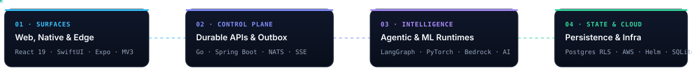

  

  
  
  
  

  

---

## Live Engineering Dashboards

  

  

  

### Recent Engineering Feed

<!-- LIVE_ACTIVITY:START -->
| System | Stack | Latest Commit | Updated |
| :--- | :--- | :--- | :--- |
| **[Systera](https://github.com/sahil0017/Systera)** | `Go` | fix(auth,web,lens): direct AWS auto-bootstrap on /v1/auth/*-boo… | `2026-11-19` |
| **[LIFEOS](https://github.com/sahil0017/LIFEOS)** | `TypeScript` | docs: add badges and Mermaid architecture diagram to README | `2026-11-19` |
| **[LowLevelDesign](https://github.com/sahil0017/LowLevelDesign)** | `Java` | docs: add repository README | `2026-11-19` |
| **[SplitwiseRepo](https://github.com/sahil0017/SplitwiseRepo)** | `Java` | docs: add repository README | `2026-11-19` |
| **[JobIntelligenceAgent](https://github.com/sahil0017/JobIntelligenceAgent)** | `Go` | feat: single-stack AWS Always-Free CareerPilot, DynamoDB dual-s… | `2026-11-18` |

Auto-updated every 6 hours via GitHub Actions · Last sync: `2026-11-22 04:48 UTC`
<!-- LIVE_ACTIVITY:END -->

---

## Flagship Systems & AI Architecture

### Autonomous Engineering & Career Intelligence

| System | Architectural Summary | Stack | Links |
| :--- | :--- | :--- | :--- |
| **[Systera](https://github.com/sahil0017/Systera)** | Autonomous engineering intelligence platform that investigates products, designs HLD/LLD graphs, simulates behavior, adversarially reviews designs, and compiles artifacts. | `Go` · `PostgreSQL RLS` · `NATS JetStream` · `React/TS` · `Chrome MV3` · `Helm` | [Repo](https://github.com/sahil0017/Systera) |
| **[JobIntelligenceAgent](https://github.com/sahil0017/JobIntelligenceAgent)** *(CareerPilot AI)* | Agentic job-intelligence & autonomous career command center with evidence-backed matching and human-in-the-loop Step Functions apply sagas. | `Go` · `FastAPI` · `LangGraph` · `React 19` · `AWS Free Tier` (`DynamoDB`, `Bedrock`) | [Repo](https://github.com/sahil0017/JobIntelligenceAgent) · [Live](https://dusmzcwbbwktl.cloudfront.net) |

### Edge, Desktop & Personal Intelligence Platforms

| System | Architectural Summary | Stack | Links |
| :--- | :--- | :--- | :--- |
| **[Nexora](https://github.com/sahil0017/Nexora)** | Privacy-first personal intelligence OS unifying mobility, wealth, health & sleep clearance, and cross-domain copilot on an event-driven architecture. | `Go (Chi)` · `PostGIS` · `Redis` · `FastAPI/PyTorch` · `AWS SNS/SQS` · `Expo` | [Repo](https://github.com/sahil0017/Nexora) |
| **[SYNTRIX](https://github.com/sahil0017/SYNTRIX)** | Native macOS desktop intelligence system with real-time Mach telemetry, local WAL SQLite daemon, and an autonomous RL Guardian Agent. | `C17` · `Go (syntrixd)` · `SQLite` · `Python ML/RL` · `SwiftUI` | [Repo](https://github.com/sahil0017/SYNTRIX) · [macOS DMG](https://github.com/sahil0017/SYNTRIX/releases) |
| **[HealthAgentApp](https://github.com/sahil0017/HealthAgentApp)** *(Sehat / CORTEX)* | Personal health records & biomarker intelligence platform with citation-grounded AI Q&A and exportable doctor-visit summaries. | `Go` · `FastAPI` · `Flutter` · `PostgreSQL + pgvector` | [Repo](https://github.com/sahil0017/HealthAgentApp) |
| **[LIFEOS](https://github.com/sahil0017/LIFEOS)** | Local-first personal intelligence platform bridging on-device SQLite storage with Cloudflare Workers AI (`Gemma 4 + BGE-M3`) and Python orchestration. | `Expo/RN` · `SQLite` · `Cloudflare Workers AI` · `FastAPI` | [Repo](https://github.com/sahil0017/LIFEOS) |

### Data Pipelines & Staff Engineering Knowledge

| System | Architectural Summary | Stack | Links |
| :--- | :--- | :--- | :--- |
| **[AttributionIQ](https://github.com/sahil0017/AttributionIQ)** | First-party marketing attribution pipeline transforming website events, order webhooks & ad spend into channel revenue and ROAS. | `Java 21` · `Spring Boot 4` · `PostgreSQL 17` · `Flyway` · `Streamlit` · `Railway` | [Repo](https://github.com/sahil0017/AttributionIQ) · [Live](https://frontend-production-22b1.up.railway.app) |
| **[SystemDesign](https://github.com/sahil0017/SystemDesign)** | Staff-level system design library (HLD, LLD, DB, API, Distributed Systems) with a GitHub Actions ML-dedup PR automation agent. | `Python` · `GitHub Actions` · `ML Classifier` · `Streamlit` | [Repo](https://github.com/sahil0017/SystemDesign) |

---

<strong>Engineering Principles & Core Technical Stack</strong> (click to expand)

 

- **Durable Control Planes:** Transactional outbox patterns, idempotent APIs, PostgreSQL Row-Level Security (RLS), lease-based DAG schedulers, and SSE/JetStream event relays.
- **Evidence-Backed Agentic AI:** Multi-agent orchestration (LangGraph, custom Go/Python runtimes), capability & tool gateways, human-in-the-loop approval sagas, and citation-grounded retrieval (`pgvector`, BGE-M3).
- **Native & Full-Stack Surfaces:** C17 Mach APIs and SwiftUI HUDs on macOS, React 19 studios, Chrome MV3 extensions, and local-first Expo/Flutter mobile apps.
- **Pragmatic Cloud Architecture:** Production topologies on AWS (DynamoDB, Step Functions, Bedrock, SNS/SQS, CloudFront), Cloudflare Workers AI, Docker, and Kubernetes/Helm.

| Layer | Technologies |
| :--- | :--- |
| **Languages** | `Go` · `Python` · `TypeScript` · `Java` · `Swift` · `C17` · `SQL` |
| **Backend & Distributed** | `Chi` · `FastAPI` · `Spring Boot` · `NATS JetStream` · `PostgreSQL` (`pgvector`, `PostGIS`, `RLS`) · `Redis` · `SQLite (WAL)` |
| **AI & Agentic Systems** | `LangGraph` · `PyTorch` · `AWS Bedrock` · `Cloudflare Workers AI` · `Ollama` · `RAG` · `Reinforcement Learning` |
| **Frontend & Native** | `React 19` · `Vite` · `Expo / React Native` · `Flutter` · `SwiftUI` · `Chrome Extensions (MV3)` · `Streamlit` |
| **Cloud & Infrastructure** | `AWS` · `Docker` · `Kubernetes / Helm` · `GitHub Actions` · `Cloudflare` · `Railway` |

**Foundations & Practice:** [LowLevelDesign](https://github.com/sahil0017/LowLevelDesign) · [SplitwiseRepo](https://github.com/sahil0017/SplitwiseRepo) · [neetcode-submissions](https://github.com/sahil0017/neetcode-submissions) · [DataX](https://github.com/sahil0017/DataX)

---

## Contribution Activity

  <picture>
    <source media="(prefers-color-scheme: dark)" srcset="./assets/snake-dark.svg" />
    <source media="(prefers-color-scheme: light)" srcset="./assets/snake-light.svg" />
    
  </picture>

